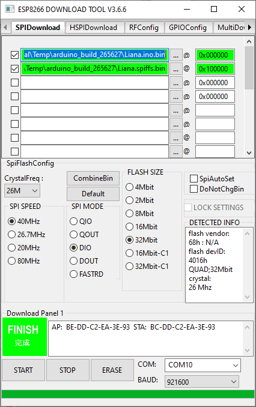
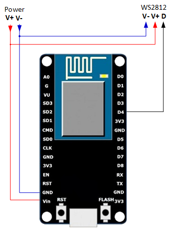

# Проект Liana: световая анимация на ESP8266/WS2812 
## Как быстро запустить
1. Подключите плату ESP, светодиодную ленту (гирлянду) и источник питания как показано ниже (подключение)
1. Загрузите в ESP файлы: [основную прошивку](https://github.com/Vasil-Pahomov/Liana/releases/latest/download/firmware.bin) по адресу 0x000000 и [файловую систему](https://github.com/Vasil-Pahomov/Liana/releases/latest/download/littlefs.bin) по адресу 0x100000 (файловая система LittleFS; старый образ spiffs.bin с новой прошивкой не работает, настройки после обновления нужно ввести заново). Нужно соответствующим образом выставить настройки: номер COM-порта, размер flash-памяти, режим SPI. Я использовал официальный инструмент Flash download tools (скачать можно [здесь](https://www.espressif.com/en/support/download/other-tools)), и работающие настройки для платы NodeMCU выглядили так:

1. После запуска подключитесь к беспроводной сети под названием "Liana-XXXX" (XXXX - идентификатор чипа, чтобы несколько модулей не мешали друг другу) и нажмите на всплывающую панель с требованием авторизации - откроется web-интерфейс Liana. Если панель не появляется, перейдите по адресу http://192.168.4.1/ в браузере. В интерфейсе можно подключиться к домашней сети WiFi.
1. После подключения Liana к сети WiFi, откройте "http://liana.local" в браузере на устройстве с iOS, MacOS or Windows, находящимися в той же сети. 
К большому сожалению, это не работает для Android - нужно знать IP-адрес Liana (в админской консоли роутера, посмотрев вывод Liana в COM-порт после старта, либо используя клиент mDNS вроде https://play.google.com/store/apps/details?id=com.dokoden.dotlocalfinder). Потом подключайтесь браузером к "http://<IP_ADDRESS>".

## Подключение

В качестве примера показана плата NodeMCU, но можно использовать любую плату с ESP8266. Нужно иметь в виду, что для других плат возможно потребуется перекомпиляция кода!
Т.е. достаточно просто подвести питание к плате, ленте/гирлянде светодиодов WS2812, и подключить выход GPIO2 модуля ESP ко входу данных первого WS2812 в цепочке.
Будьте внимательны при выборе блока питания - большинство плат с ESP8266 имеют стабилизатор напряжения, но голая ESP8266 требует точно 3,3 В. Ленты/гирлянды WS2812 требуют 5 В или 12В. 
Можно использовать разные блоки питания для светодиодов и для ESP; в этом случае у них объединяются "земли".
Также убедитесь, что блок питания достаточно мощный для светодиодов и модуля ESP. Слишком слабый блок может вызвать нежелательные побочные эффекты вроде спонтанных перезагрузок, искажения цветов и т.п.
Модулю ESP обычно хватает 500 мА, каждый светодиод WS2812 может кушать до 60 мА.

## Как собрать
1. Сейчас проект собран для PlatformIO (https://platformio.org/) и Visual Studio Code (https://code.visualstudio.com/)
1. Настройки PlatformIO и Visual Studio code хорошо описаны, например, здесь: https://docs.platformio.org/en/latest/integration/ide/vscode.html
1. Все зависимости прописаны в файле platformio.ini и загружаются автоматически.
1. Параметры конкретного устройства (пароль и адрес для OTA-загрузки, кнопка и индикаторный светодиод, пин ленты, имя точки доступа, часовой пояс) задаются в файле `platformio_local.ini`, который не хранится в репозитории. Скопируйте `platformio_local.ini.example` и поправьте под себя; список флагов есть в `src/config.h`.
1. Не забудьте при прошивке также загрузить образ файловой системы LittleFS (выполнить задачу "Upload Filesystem Image")
1. Логика без привязки к железу (цвета, палитры, маски, выбор эффекта) покрыта тестами на хосте: `pio test -e native`.

## Управление модулем
Сейчас после подачи питания модуль начинает проигрывать эффекты в случайном порядке со сменой каждые 30 секунд. В web-интерфейсе можно вручную переключать анимации и палитры, а также включать и выключать ленту.
Пока открыта основная страница web-интерфейса, автоматической смены эффектов не происходит!
Длительным нажатием на кнопку эффекта или палитры можно исключить их из случайного перебора при закрытом web-интерфейсе. Так можно оставить только понравившиеся эффекты и палитры.
В конце списка находится особенный эффект (Магия), разработанный преимущественно для новогодних ёлок. Когда он выбран, можно управлять светом при помощи наклонов устройства, на котором открыт web-интерфейс. Пример показан в этом видео: https://youtu.be/ZXqNeq31DUs. Наклоняйте устройство для смены "целевой точки", поворачивайте его для смены цвета и делайте выпад для подсветки.
ВАЖНО: Этот эффект не показывается, если браузер устройства запрещает доступ к датчикам (https://w3c.github.io/deviceorientation/#security-and-privacy). К сожалению это ограничение распространяется на все сайты, работающие не по HTTPS. Т.к. настройка HTTPS в локальной сети ни разу не тривиальная, единственный известный мне способ заставить эффект работать - использовать браузер Chrome, включить опцию `--unsafely-treat-insecure-origin-as-secure` на странице chrome://flags и указать IP-адрес модуля в этой опции.

Ночной режим: в заданные часы (по умолчанию с 21:00 до 6:00) играет один эффект ("Звёзды") с пониженной яркостью. Включается и настраивается на странице "Лента"; время берётся по NTP, часовой пояс задаётся флагом `TIMEZONE_POSIX` при сборке.

Список эффектов и палитр прошивка отдаёт по адресу `GET /api/catalog`, текущее состояние - `GET /api/state`. Web-интерфейс строит кнопки из этого каталога и общается с модулем по WebSocket (порт 81) JSON-сообщениями, описание в `src/websocket.cpp`.

## Управление по MQTT
Соединение с брокером MQTT настраивается через web-интерфейс. Liana работает только как клиент MQTT.
Команды отправляются простым текстом. Ниже перечислены эти команды. Выражения в фигурных скобках **{XXX}** должны быть заменены на соответствующие значения
В конце команд, содержащих параметры, рекомендуется добавлять пробел или символы CR/LF.
1. **on** - включить
1. **off** - выключить
1. **palette={номер палитры}** - выбрать палитру, номера начинаются с 0
1. **animation={номер эффекта}** - выбрать анимацию, номера начинаются с 0
1. **duration={секунды}** - устанавливает длительность текущего эффекта; после истечения времени возобновляется случайный перебор
1. **brightness={яркость}** - устанавливается яркость (0..255)
1. **brightness up** - увеличивает яркость 
1. **brightness down** - уменьшает яркость

# Project Liana: ESP8266/WS2812 LIght ANimation
## How to start
1. Connect your ESP, LED strip and power source as shown below (Wiring)
1. Upload binary files: [program file](https://github.com/Vasil-Pahomov/Liana/releases/latest/download/firmware.bin) at 0x000000, and [LittleFS file](https://github.com/Vasil-Pahomov/Liana/releases/latest/download/littlefs.bin) at 0x100000 (the old spiffs.bin image does not work with the new firmware; settings have to be entered again after the upgrade). You should adjust settings for your board, particuarly COM port number, flash size, and SPI mode. I used official Flash download tools (can be found [here](https://www.espressif.com/en/support/download/other-tools)), and my working settings for NodeMCU board looked like this:

1. Connect to the "Liana-XXXX" wireless network (XXXX is the chip id, so that several units don't clash) and tap on pop-up authorization panel. You'll be brought directly to the Liana web interface. If the panel didn't open, go to http://192.168.4.1/ in the browser. You can configure connection to your WiFi network there.
1. Once you have connected Liana to your WiFi, open "http://liana.local" in web browser of any iOS, MacOS or Windows device on the same network. This does not work for Android however, you should find IP address of the Liana (e.g. in your router admin console, seeing Liana COM port output after startup, or using mDNS client like https://play.google.com/store/apps/details?id=com.dokoden.dotlocalfinder). Then type "http://<IP_ADDRESS>" in Android browser.

## Wiring

Here example of NodeMCU is shown, but you can use any ESP8266 board. But note you may have to recompile the code! 
You power the board, power the WS2812 chain, and connect GPIO2 output of ESP to the data input of the firsh WS2812 in chain, that's all.
Be sure you use appropriate power source; most of ESP8266 board have voltage stabilizer but "raw" ESP8266 require 3.3V while WS2812 strips require 5V or 12V. You can use different power sources for ESP and the strip, you connect grounds then. Also, be sure that there's enough power for your LEDs and ESP; too weak power source can cause unintended side effects like random rebooting, wrong coloring etc.
500 mA is typically enough for ESP board. Each WS2812 LED eats up to 60 mA.

## How to compile 
1. Currently the project is built with PlatformIO (https://platformio.org/) and Visual Studio Code (https://code.visualstudio.com/)
1. Setting up PlatformIO and Visual Studio Code is described here: https://docs.platformio.org/en/latest/integration/ide/vscode.html
1. All library dependencies are enumerated in platformio.ini file and should be downloaded automatically.
1. Device-specific settings (OTA password and upload address, button and indicator LED, strip pin, access point name, time zone) go to `platformio_local.ini`, which is not committed. Copy `platformio_local.ini.example` and adjust it; the flags are listed in `src/config.h`.
1. Don't forget to upload the LittleFS image (Run task "Upload Filesystem Image")
1. The hardware-independent logic (colors, palettes, masks, effect choice) has host-side tests: `pio test -e native`.

## Controlling the unit
Currently, when unit is powered on, it starts to play animations in random order, changing every 30 seconds. With web browser, you can control animations and palettes manually. Also you can switch the strip on and off.
While main web page is open, no automatic change occurs.
Long tapping on animation or palette disables it (excludes from random enumeration when web interface is closed).
There's special animation at the end of the list (called 'Magic'), designed for New Year trees mainly. When it's selected, you can control the lights with your device accelerometer (as shown in this video: https://youtu.be/ZXqNeq31DUs). You tilt the device to alter "target point", roll it to change color and lunge to highlight.
IMPORTANT NOTE: the Magic animation is hidden when browser restricts access to mobile device sensors (https://w3c.github.io/deviceorientation/#security-and-privacy). Unfortunately the restriction applies to all non-HTTPS sites. Since setting up proper HTTPS on local devices is cumbersome, the only way I know to make this animation work is using Chrome and enable `--unsafely-treat-insecure-origin-as-secure` option in chrome://flags and specify your IP address in the option value textbox.

Night mode: during the configured hours (21:00 to 6:00 by default) a single effect ("Stars") plays with reduced brightness. It is enabled and configured on the "Strip" settings page; the time comes from NTP, the time zone is the `TIMEZONE_POSIX` build flag.

The firmware lists its effects and palettes at `GET /api/catalog` and the current state at `GET /api/state`. The web interface builds its buttons from the catalog and talks to the unit over WebSocket (port 81) with JSON messages described in `src/websocket.cpp`.

## MQTT operation
MQTT broker connection is set up in web interface. Liana works as MQTT client only.
Commands are sent in plain text. Below description of commands goes. **{XXX}** is replaced with actual value of parameter.
It's recommended to add a space or CR/LF chars to the end of parametrized commands.
1. **on** - turn on
1. **off** - turn off
1. **palette={palette index}** - set palette, index numbering starts from 0
1. **animation={animation index}** - set animation, index numbering starts from 0
1. **duration={seconds}** - sets current effect (palette/animation) duration; random cycling starts after specified time elapses
1. **brightness={brightness}** - sets brightness (0..255)
1. **brightness up** - increases brightness (exponential)
1. **brightness down** - decreases brightness (exponential)
